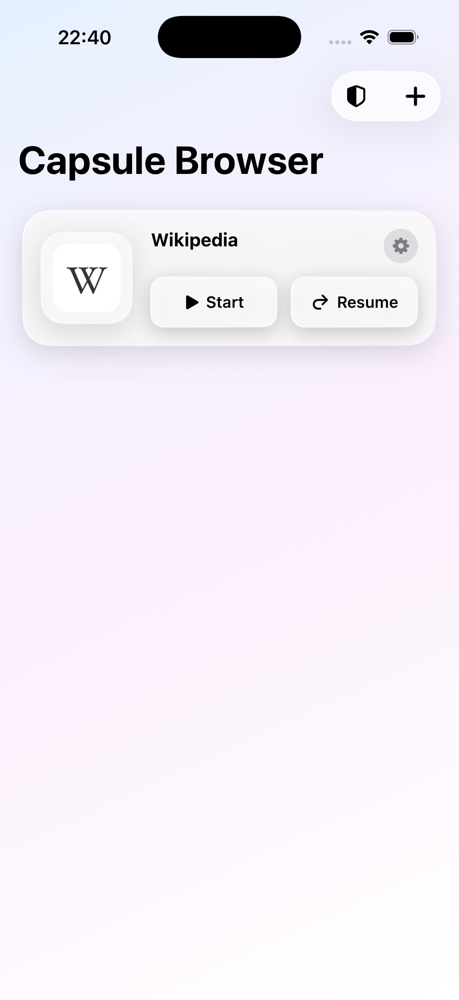
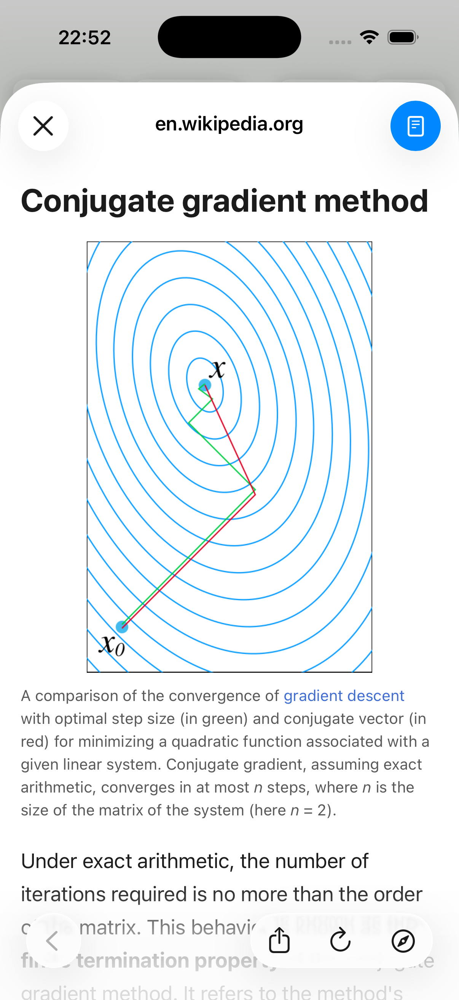
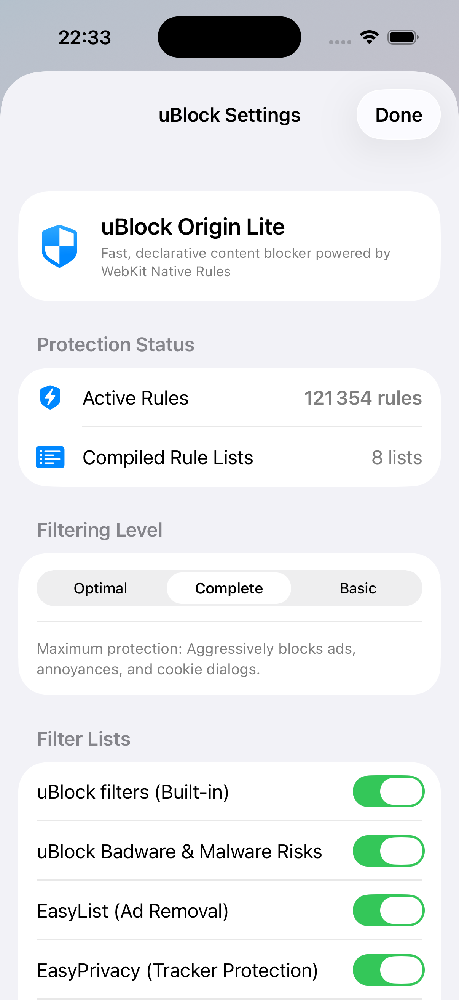

# Capsule Browser
[](https://github.com/Eddy-Barraud/Capsule-browser/actions/workflows/release.yml)

**Capsule Browser** is a privacy-first web application container for macOS and iOS that turns websites into independent, isolated web capsules.

---

### 🛡️ Privacy & Multi-Account Isolation

* **🚫 Zero Cross-Site Tracking:** Each capsule runs in an isolated WebKit container with its own data store. Cookies, storage, and trackers cannot leak across capsules.
* **👥 Multi-Account & Capsule Groups:** Create multiple capsules for the same service (e.g., *Personal* vs. *Work*), or group related capsules together in a **Capsule Group** to share cookies.
* **🛡️ Integrated uBlock Origin Lite:** Native WebKit content-blocking rulesets, cosmetic element hiding, scriptlet defusers, and dedicated YouTube ad-blocking scripts.
* **☁️ Optional iCloud Sync:** Local-only storage by default. Enable iCloud Sync anytime in Settings with guided local/cloud migration and per-capsule conflict resolution.

<div align="center"></div>

---

## Features

- **Isolated Web Capsules & Groups:** Independent cookies and storage per capsule, or shared sessions across capsules within a group.
- **Configurable Default Search Engine:** Choose between **DuckDuckGo**, **Google**, **Bing**, or a **Custom Search URL** (`?q=`, `%s`, `{query}`) for the home search bar and capsule address bars.
- **Optional iCloud Sync:** Disabled by default (`LocalStore`). Toggle on/off in Settings with prompts to upload, replace, or keep data locally and resolve same-name capsule clashes one at a time.
- **macOS Window Modes & Sleeping Tabs:** Switch between **One View**, **Separate Windows**, and **Native macOS Tabs**, with automatic background tab freezing to save CPU and memory.
- **On-Device AI Summaries:** Summarizes the first 3 rendered PDF pages of any web page using Apple Foundation Models, automatically adapting instructions to the system language (English, French, Spanish).
- **Anti-Tracking & Ad-Blocking:** Built-in uBlock Origin Lite filter lists, regional filters, and Safari Reader mode integration.
- **Share Extension:** Open links directly into an existing or ephemeral capsule via the **Open in a capsule** extension.

## Build and Run

1. Clone with submodules:

   ```sh
   git clone --recurse-submodules https://github.com/Eddy-Barraud/Capsule-browser.git
   ```

2. Open `isowebapps.xcodeproj` in Xcode, select the `Capsule Browser` target/scheme, and run on macOS or iOS.

Command-line build:

```sh
xcodebuild -project isowebapps.xcodeproj -target "Capsule Browser" -sdk macosx CODE_SIGNING_ALLOWED=NO build
xcodebuild -project isowebapps.xcodeproj -target "Capsule Browser" -sdk iphonesimulator CODE_SIGNING_ALLOWED=NO build
```

## Key Source Files

- `isowebappsApp.swift`: App entry point, scene configuration, and menu commands.
- `CloudSyncManager.swift`: Dual `ModelContainer` manager (`LocalStore` vs. CloudKit), data migration, and sequential sync conflict resolution.
- `ContentView.swift`: Home screen grid, quick search bar, and capsule/group management.
- `WebAppItem.swift` & `WebAppGroup.swift`: SwiftData models for capsules, groups, and serialized cookies.
- `GroupSettingsSheet.swift`, `AddWebAppSheet.swift`, `AddGroupSheet.swift`: Creation and management sheets for capsules and groups.
- `WebAppContainerView.swift` & `IsolatedWebView.swift`: WebKit container, toolbar/URL bars, sleeping tabs, and 3-page PDF capture.
- `WindowPresentationMode.swift`: macOS Single Window, Separate Windows, and Tabs management plus Dock reopen handling.
- `AISummarizer.swift` & `Prompts/`: On-device Apple Intelligence summarization with localized prompts (`en`, `fr`, `es`).
- `GeneralSettingsView.swift`: Settings for iCloud Sync, Default Search Engine, macOS window modes, sleeping tabs, and uBlock Origin Lite filter lists.
- `UBlockOriginExtensionManager.swift` & `UBlockRuleCompiler.swift`: Compiles uBlock DNR rulesets into native `WKContentRuleList` instances.

## Credits & License

- **Copyright © 2026 Eddy Barraud.** Licensed under the **GNU General Public License v3.0 (GPLv3)** — see [LICENSE](LICENSE) for full details.
- **uBlock Origin Lite (`uBOL-home`):** Ad-blocking rulesets and scriptlets are powered by [uBlock Origin Lite](https://github.com/uBlockOrigin/uBOL-home) by **Raymond Hill (`gorhill`)** and contributors, licensed under [GPLv3](shared/uBOL-home/LICENSE).
- **Filter Lists:** Includes rules compiled from EasyList, EasyPrivacy, AdGuard, Peter Lowe's Ad and tracking server list, and URLhaus (abuse.ch), maintained by their respective authors.

